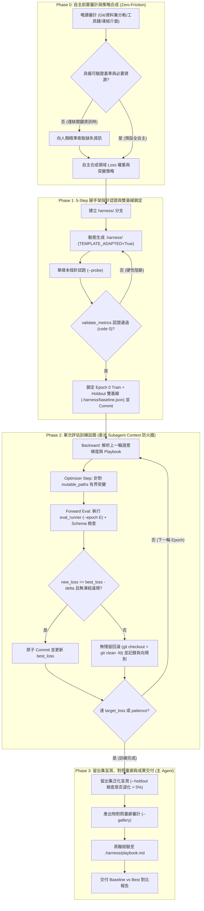

# Harness Optimizer (`harness-optimizer`)

> **Agent-Native 自主遞迴式程式碼、演算法、Prompt 與評估 Harness 優化外掛（靈感源自 Google Research Harness2，極小化人類介入）。**

---

## 🌟 核心理念（Core Principles）

1. **Agent-Native 全自主閉環（Zero-Friction Autonomy）**：
   - 預設由 Agent 自主完成專案審計、測試/資料集分軌、Loss 權重配置、腳手架探針認證與多輪訓練，**不以繁瑣的選擇題打斷人類**。
   - **人類最小介入邊界**：僅在「專案完全缺乏評估基準（Missing Oracle）」、「缺少外部金鑰/硬體資源」或「必須破壞公開 API 契約且意圖不明」時，才向使用者精準提問。
2. **強制探針認證與反樣板閘門（5-Step Probe & Anti-Boilerplate Gate）**：
   - 嚴格執行 **Zero-Mutation Boundary**：未將 `eval_runner.py` 適配至目標專案（`TEMPLATE_ADAPTED = True`）並通過 `--probe` 與 `validate_metrics.py` 驗證前，絕對禁止修改任何業務代碼。
3. **黑箱資料集隔離與雙基線防過擬合（Holdout Anti-Overfitting Gate）**：
   - Epoch 0 同步鎖定 Train 與 Holdout 雙基線（`.harness/baseline.json`），並以 Epoch 0 延遲作為相對分母正規化 Loss。
   - 訓練期間嚴禁讀取 Holdout 資料；結案時若 Holdout Loss 退化超過 `max_holdout_degradation`（預設 `5%`），自動觸發過擬合警報與回滾。
4. **單次評估迴圈、雜訊門檻與無殘留回滾（Single-Pass & Clean Rollback）**：
   - 每輪 Epoch 依據上一輪語意梯度進行有界突變（Bounded Mutation），僅執行 **1 次** 評估；必須跨越 `min_improvement_delta`（預設 `0.005`）才予以 Commit，否則執行 `git checkout -- <mutable_paths> && git clean -fd <mutable_paths>` 徹底清除修改與新增暫存檔。

---

## 🔄 優化生命週期（Agent-Native Workflow Phases）



---

## 📂 外掛目錄結構

```text
plugins/harness-optimizer/
├── plugin.json                 # 外掛宣告清單 (Agent-Native Autonomous Edition)
├── README.md                   # 外掛架構與操作指南
├── agents/
│   └── harness-worker.md       # [專屬 Subagent] 封裝 Phase 2 訓練迴圈、Tier-1 熔斷與無殘留回滾之專用 Worker
├── rules/
│   └── AGENTS.md               # [規則] 自主執行邊界、5-Step 認證閘門、防過擬合與無殘留回滾硬規範
└── skills/
    └── harness-optimizer/
        ├── SKILL.md            # 核心技能 SOP（Phase 0 ~ Phase 3 全自主工作流）
        ├── templates/          # 供動態合成 .harness/ 腳手架之元架構模板
        │   ├── config.json.tmpl       # 超參數、相對基線、可變路徑與凍結介面設定
        │   ├── eval_runner.py.tmpl    # 支援 probe/train/holdout/gallery 與 Tier-1 熔斷之 Runner 骨架
        │   └── playbook.md.tmpl       # 領域無關之正向模式與負向陷阱蒸餾模板
        └── scripts/
            └── validate_metrics.py    # 強制驗證 Schema、樣本數與 TEMPLATE_ADAPTED 之阻斷式檢驗器
```

---

## ⚡ 快速上手（Quick Start）

1. **直接下達目標**：
   > 「使用 `harness-optimizer` 優化 `src/tikz` 的幾何渲染品質與編譯速度。」
2. **Agent 自主閉環執行**：
   - 若專案具備測試或資料集，Agent 將**零打擾**自動完成：建立 `harness/<topic>` 分支 $\rightarrow$ 合成 `.harness/eval_runner.py` $\rightarrow$ 通過 `--probe` 與 `validate_metrics.py` 認證 $\rightarrow$ 鎖定 Epoch 0 Train/Holdout 雙基線 $\rightarrow$ 啟動 Subagent 多輪訓練與自動回滾 $\rightarrow$ 執行 Holdout 防過擬合盲測與 `--gallery` 畫廊驗收。
   - 僅在專案缺少測試基準或外部必要資訊時，Agent 才會向您詢問補充。
