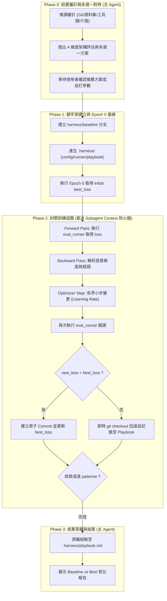

# Harness Optimizer (`harness-optimizer`)

> **遞迴式程式碼、演算法、Prompt 與評估 Harness 自動優化外掛（靈感源自 Google Research Harness2）。**

---

## 🌟 核心理念（Core Principles）

1. **程式碼即模型參數（Code as Trainable Parameters）**：
   - 將待優化的程式碼邏輯、演算法、LLM Prompt 或評估 Harness 視為可微調的參數。
   - 透過有結構的 Epoch 迭代、複合損失函數（Composite Loss）與語意梯度（Semantic Gradients），驅動程式碼自主演進。
2. **黑箱資料集嚴格隔離（Strict Black-Box Isolation）**：
   - 嚴防評估資料洩漏或過擬合（Overfitting）。測試集僅透過 `eval_runner` 封閉執行，禁止 Agent 直接讀取原始測試樣例或預期答案。
   - 所有反饋均以標準化 JSON 統計指標（`composite_loss`, `pass_rate`, `latency_ms`）與去識別化的語意梯度回傳。
3. **雙層協同架構（Two-Tier Context Firewall）**：
   - **主 Agent（Orchestrator）**：專注於 Phase 0 前置審計、人機對齊確認、建立 Baseline，以及最終成果驗收。
   - **Subagent（Worker）**：將多輪（`max_epochs >= 3`）訓練迴圈封裝於獨立的 Subagent Session 執行，中途的大量測試報錯、失敗軌跡與編譯堆疊完全不污染主對話 Context。
4. **零容忍即時回滾（Zero-Tolerance Atomic Rollbacks）**：
   - 每一輪 Mutation 嚴格限制在設定的 Learning Rate（修改行數/檔案數）內。
   - 一旦出現效能或正確率衰退（`new_loss >= best_loss`），立即執行 `git checkout -- <files>` 回滾，杜絕錯誤累積。

---

## 🔄 優化生命週期（Workflow Phases）



---

## 📂 外掛目錄結構

```text
plugins/harness-optimizer/
├── plugin.json                 # 外掛宣告清單
├── README.md                   # 外掛架構與操作指南
├── rules/
│   └── AGENTS.md               # [規則] 黑箱資料隔離、原子回滾與雙層 Context 防火牆硬規範
└── skills/
    └── harness-optimizer/
        ├── SKILL.md            # 核心技能 SOP（Phase 0 ~ Phase 3）
        ├── templates/          # 供快速產生 .harness/ 腳手架之模板
        │   ├── config.json.tmpl       # 超參數、Loss 權重與凍結介面設定
        │   ├── eval_runner.py.tmpl    # Python 通用黑箱測試 Runner 模板
        │   └── playbook.md.tmpl       # 學習規則與負向經驗蒸餾模板
        └── scripts/
            └── validate_metrics.py    # 驗證 Runner 輸出 JSON Schema 之檢驗工具
```

---

## ⚡ 快速上手（Quick Start）

1. **觸發技能**：
   在對話中告知 Agent 欲優化的程式碼或演算法：
   > 「請使用 `harness-optimizer` 優化 `src/algo.py` 的執行效率與測試通過率。」
2. **Phase 0 確認**：
   Agent 將自動掃描專案並提出診斷報告（包含隔離模式、Loss 權重配比、Mutation 策略與 Stopping 條件）。核准後即開始建置基線。
3. **自動化隔離訓練**：
   Agent 建立 `.harness/` 腳手架後，自主啟動 Subagent 在背景進行多輪訓練、回滾與 Checkpoint 提交。
4. **成果收斂**：
   訓練完成後，主 Agent 交付最終效能對比表格與 `.harness/playbook.md` 規則庫。
